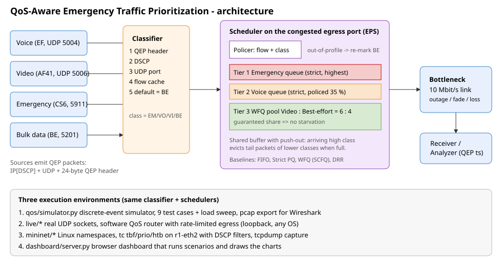

# QoS-Aware Emergency Traffic Prioritization

Classify **voice, video, emergency and ordinary traffic** and prioritise packets during congestion
with scheduling algorithms. The project contains a custom protocol (QEP), a multi-stage classifier,
five schedulers (FIFO, Strict Priority, WFQ, DRR and a proposed hybrid **EPS**), a discrete-event
simulator with 10 test cases (normal, congestion, outage, degradation, attack, noise, starvation,
lossy link, load sweep), a live UDP demo with a real software QoS router, a Mininet/`tc` emulation,
a web dashboard and Wireshark verification tooling.

**Zero dependencies** - everything runs on the Python 3.8+ standard library
(Mininet, tshark and Wireshark are optional).  Quick start: see `instructions.txt`.

```
python3 -m unittest -v tests.test_qos          # 31 tests, ~20 s
python3 run_simulation.py --scenario all       # every test case -> results/report_all.html
python3 live/run_live_demo.py                  # real sockets, real rate-limited router
python3 dashboard/server.py                    # http://localhost:8080
```

The dashboard has separate Simulation and Live demo views. The live view runs real loopback UDP
traffic through the software QoS router and displays class metrics, SLA results, router counters,
and emergency-delay charts alongside the simulator's results. The server prints timestamped request,
simulation, and live-run logs to the terminal where it was started.

---------------------------------------------------------------------------------------------------

## 1. Problem statement and objectives

During disasters, the traffic that matters most (alarms, sensor telemetry, dispatch voice) shares links with bulk data. A plain FIFO queue gives every packet the same fate: when the bottleneck
saturates, emergency packets wait behind (or are dropped with) bulk traffic.

**Objectives**

| # | Objective | How it is measured |
|---|-----------|--------------------|
| O1 | Classify packets into emergency / voice / video / best-effort, robustly against missing or wrong markings | classification accuracy, flow-cache hit ratio (TC7) |
| O2 | Keep emergency & voice delay, jitter, loss within SLA during congestion | p99 delay, jitter, loss vs SLA (TC2, TC3) |
| O3 | Survive link failures and recover quickly | emergency loss, recovery time (TC4, TC5) |
| O4 | Not be abusable: a flow that *claims* to be emergency must not destroy other traffic | TC6 |
| O5 | Not starve lower classes | best-effort throughput, video loss (TC8) |
| O6 | Quantify the trade-off between schedulers | load sweep (TC10) |

**SLA targets used for PASS/FAIL**: emergency p99 delay <= 50 ms and loss <= 0.1 %; voice p99 <= 150 ms,
jitter <= 30 ms, loss <= 1 %; video p99 <= 300 ms, loss <= 2 %. Delay is one-way (queueing +
serialization + 5 ms propagation).

## 2. Architecture and topology



Logical topology (simulation, live demo and Mininet all model the same thing):

```
 h_voice  (10.0.1.1, EF)  --\
 h_video  (10.0.1.2, AF41) --+-- s1 -- r1 (classifier + scheduler)  ==10 Mbit/s bottleneck== s2 -- h_srv (10.0.2.2)
 h_emerg  (10.0.1.3, CS6) --+                                         (5 ms propagation)
 h_bulk   (10.0.1.4, BE)  --/
```

Only the router egress port is congested, so the scheduler is the only variable that changes
between runs - results isolate its effect.

## 3. Protocol / message-format design (QEP)

Each datagram is `IPv4 (DSCP) | UDP | 24-byte QEP header | payload`.

```
 0               1               2               3
 +---------------+---------------+---------------+---------------+
 |       Magic 0x5145 'QE'       | Ver(4)|Class(4)|   Flags (8)   |
 +---------------+---------------+---------------+---------------+
 |           Flow ID             |   DSCP (8)    |  Reserved (8) |
 +---------------+---------------+---------------+---------------+
 |                       Sequence number (32)                    |
 +---------------------------------------------------------------+
 |                  Timestamp, ns since epoch (64)               |
 +---------------+---------------+---------------+---------------+
 |        Payload length         |     Header checksum (16)      |
 +---------------+---------------+---------------+---------------+
```

| Field | Meaning |
|---|---|
| Class | 0 emergency, 1 voice, 2 video, 3 best effort (== strict priority number) |
| Flags | `0x01` ALERT (first packet of an emergency event), `0x02` RETX, `0x04` LAST, `0x08` PREEMPT_REQUEST |
| Timestamp | sender clock - lets the receiver / Wireshark compute one-way delay |
| Checksum | RFC 1071 Internet checksum over the header (field zeroed) - corrupted headers are rejected |

| Class | DSCP | UDP port | Typical source |
|---|---|---|---|
| Emergency | 48 (CS6) | 5911 | alarms, sensor events (172 B, 5-60 pps/source) |
| Voice | 46 (EF) | 5004 | G.711-like, 212 B every 20 ms (85 kbit/s per call) |
| Video | 34 (AF41) | 5006 | 30 fps, I-frame x4 every second, 1252 B packets in bursts |
| Best effort | 0 | 5201 / 80 / 443 / 8080 | bursty bulk (TCP-like), 200-1500 B |

Reference: `qos/protocol.py`; Wireshark dissector: `docs/qep_dissector.lua`.

## 4. Classifier (`qos/classifier.py`)

Staged, cheapest-trustworthy-first: **QEP header -> DSCP -> UDP port -> flow cache -> default (BE)**.
DSCP 0 is treated as "unknown" (a stripped marking looks identical to best effort), so it falls through
to later stages. The *flow cache* remembers the class of a flow once any packet of it was identified, so
later packets with stripped/corrupted markings are still classified correctly - this is what turns
99.7 % (stateless) into 100 % accuracy (TC7).

## 5. Scheduling algorithms (`qos/schedulers.py`)

| Name | Description | Weakness it exposes |
|---|---|---|
| `fifo` | single tail-drop queue (baseline, no QoS) | everything suffers equally |
| `pq` | strict priority, per-class buffers | starves low classes; trusts markings |
| `wfq` | Self-Clocked Fair Queueing, weights 40/30/20/10 | emergency only gets its weight under attack |
| `drr` | Deficit Round Robin, same weights | coarser delay (quantum rounds) |
| **`eps`** | **proposed hybrid** (below) | needs call-admission control for voice over-subscription |

**EPS (Emergency Priority Scheduler)** combines the best parts:

1. **Tier 1 - Emergency**: strict highest priority.
2. **Tier 2 - Voice**: strict second priority.
3. **Tier 3 - Video : Best-effort** share the rest by WFQ (6 : 4) -> no starvation.
4. **Policing for tiers 1-2**: a packet must conform to a *per-flow* token bucket **and** an *aggregate*
   class bucket (emergency 20 % of link, voice 35 %). Out-of-profile packets are **re-marked to best
   effort**, not dropped. Per-flow policing is what stops one spoofed flow from eating the aggregate
   reservation and demoting genuine alarms (a first version without it failed TC6 - see section 9).
5. **Shared buffer with push-out**: when the buffer is full, an arriving higher-class packet evicts tail
   packets of lower classes, so emergency traffic never loses its buffer slot to bulk data. Video and BE
   have per-queue caps to limit bufferbloat.

## 6. Implementation overview

| Path | Purpose |
|---|---|
| `qos/protocol.py`, `classifier.py`, `schedulers.py`, `packet.py` | protocol, classifier, schedulers (shared by all three environments) |
| `qos/traffic.py`, `simulator.py`, `metrics.py`, `scenarios.py` | traffic models, event-driven bottleneck link (outage/degradation/loss), metrics, test-case catalogue |
| `qos/report.py`, `qos/pcapio.py` | Markdown / CSV / HTML+SVG reports, pcap writer/reader |
| `run_simulation.py` | CLI for all test cases |
| `live/` | real UDP sender, software QoS router, receiver, analyzer, one-command demo |
| `mininet/mn_qos_topo.py` | Mininet topology + `tc` tbf / prio / htb with DSCP filters |
| `dashboard/` | stdlib web dashboard for simulations and the live UDP demo |
| `tools/pcap_verify.py`, `docs/qep_dissector.lua` | packet-level verification |
| `tests/test_qos.py` | 31 automated tests (unit + scenario assertions) |

Metrics: one-way delay (avg/p50/p95/p99/max), jitter (mean |delay variation| of consecutive packets
per flow), loss (queue / push-out / link), throughput, SLA verdicts, recovery time (time after a failure
ends until emergency delay is back under 100 ms), classification accuracy, flow-cache hit ratio.

## 7. Test cases and results (simulation, 10 Mbit/s link, seed 1, 20 s runs)

Offered load: voice 20 calls (1.7 Mbit/s), video 3 streams (3 Mbit/s), emergency 10 sources, bulk traffic.
`P/F` = SLA verdict for emergency / voice / video. Full tables: `results/summary_all.md`, charts: `results/report_all.html`.

| TC | Condition | FIFO | Strict PQ | WFQ | DRR | **EPS** |
|----|-----------|------|-----------|-----|-----|---------|
| **TC1** normal (~70 %) | EM p99 ms / SLA | 42.4 P/P/P | 6.3 P/P/P | 6.3 P/P/P | 9.4 P/P/P | 6.3 P/P/P |
| **TC2** congestion (~170 %) | EM p99 ms / EM loss % / SLA | 105.5 / 2.91 **F/F/F** | 6.3 / 0 P/P/P | 6.5 / 0 P/P/P | 9.8 / 0 P/P/P | 6.3 / 0 P/P/P |
| **TC3** disaster surge in congestion | EM p99 ms / EM loss % | 105.4 / 2.54 **F** | 6.3 / 0 P | 7.3 / 0 P | 10.1 / 0 P | 6.3 / 0 P |
| **TC4** 2 s link outage | EM loss % / recovery ms | 19.9 / 7163 | 16.4 / 0.9 | 16.4 / 0 | 16.4 / 0 | **0.0** / 0 |
| **TC5** capacity drops to 35 % | EM p99 / voice p99 ms | 291.6 / 291.5 **F/F** | 8.2 / 9.6 P/P | 10.2 / 181.8 P/**F** | 27.4 / 180.5 P/**F** | 8.4 / 9.7 P/P |
| **TC6** spoofed 8 Mbit/s "emergency" flood | EM loss % / video loss % | 1.53 / 24.8 F | 0.69 / **50.2** F | 2.28 / 28.0 F | 4.72 / 27.7 F | **0.00 / 0.00** P/P/P |
| **TC7** noisy markings | classification accuracy / EM SLA | - / F | P | P | P | 100 % / P |
| **TC8** voice over-subscription (90 calls) | BE kbit/s / video loss % | 885 / 56 | **15 / 39** | 1643 / 8.1 | 1643 / 8.1 | 149 / 0.07 |
| **TC9** 2 % random link loss | EM p99 ms / EM loss % | 104 / 2.5 | 6.3 / 2.0 | 6.4 / 1.9 | 9.7 / 1.5 | 6.3 / 2.1 |

**TC10 load sweep** - emergency p99 delay (ms) as bulk load grows 1 -> 15 Mbit/s:
FIFO `36 -> 57 -> 105 -> 105 ...` (grows until the buffer limit), all QoS schedulers stay flat
(PQ/EPS 6.3 ms, WFQ ~7 ms, DRR ~10 ms).

**Classifier ablation (TC7 noise: 25 % DSCP stripped, 10 % wrong port, header on 80 %)**

| Mode | Accuracy | Emergency loss | Emergency p99 |
|---|---|---|---|
| DSCP only | 85.86 % | 1.23 % | 117 ms |
| DSCP + port | 98.46 % | 0.23 % | 117 ms |
| header only | 88.25 % | 1.41 % | 118 ms |
| header + DSCP + port (stateless) | 99.72 % | 0.00 % | 6.3 ms |
| **+ flow cache (full)** | **100.00 %** (32.7 % of packets served from cache) | 0.00 % | 6.3 ms |

**Live demo (real UDP sockets, 1 Mbit/s software router, ~190 % offered load, 8 s)** - `results/live_*.txt`

| Scheduler | Emergency p99 / loss | Voice p99 | SLA (EM/VO/VI) |
|---|---|---|---|
| FIFO | 200.7 ms / 3.3 % | 202.2 ms | F/F/F |
| Strict PQ | 12.0 ms / 0 % | 14.7 ms | P/P/P |
| WFQ | 13.8 ms / 0 % | 13.7 ms | P/P/P |
| DRR | 38.3 ms / 0 % | 36.4 ms | P/P/P |
| EPS | 11.9 ms / 0 % | 15.1 ms | P/P/P |
| *with 900 kbit/s spoofed flood:* FIFO / PQ / EPS | 203 ms / **30.3 ms, 0.62 % loss** / **13.6 ms, 0 %** | 202 / 112 / 19.6 ms | F,F,F / F,P,F / **P,P,P** |

Live numbers vary a few ms between runs (OS scheduling); the ordering is stable.

### Honest observations (read these before the viva)
* **TC1**: at ~70 % load even FIFO meets the SLA - QoS only matters under congestion. That is the expected baseline.
* **TC2/TC3**: *any* QoS scheduler fixes congestion for emergency/voice because those flows are low-rate.
  WFQ/DRR are slightly slower than strict priority (weighted sharing, DRR round granularity).
* **TC4**: every scheduler "fails" the whole-run SLA because packets arriving *during* the 2 s outage
  are stuck for up to 2 s. What differs is **loss**: EPS loses 0 % emergency packets (push-out keeps their
  buffer space) vs 16-20 % for the others, and recovery after the link returns.
* **TC5**: video must degrade (3 Mbit/s demand, ~1.5 Mbit/s left) - EPS and PQ protect emergency + voice; WFQ/DRR let voice suffer.
* **TC6**: strict PQ and WFQ/DRR lose emergency SLA under a spoofed flood; EPS holds because of per-flow policing.
  *Limitation*: an attacker using many flow IDs would be bounded only by the aggregate cap -> real deployments need
  authentication of emergency sources (e.g. HMAC token in the QEP reserved field, or an allow-list).
* **TC8**: strict PQ starves bulk (15 kbit/s) and video (39 % loss). EPS protects video and BE but because voice is
  capped at 35 % of the link, 90 calls (7.6 Mbit/s) exceed it and ~20 % of voice is demoted. In practice this is solved
  with **call admission control**, which is outside this project.
* **TC9**: random link loss hits all classes equally (~2 %) - scheduling cannot fix it; FEC/retransmission (QEP `RETX` flag) would.

## 8. Wireshark / packet-level verification

* `run_simulation.py --scenario tc2 --pcap results/tc2_eps.pcap --pcap-scheduler eps` writes the packets *as they leave
  the bottleneck* (Ethernet/IPv4/UDP/QEP, real DSCP bits, valid IP checksums). Open it in Wireshark with
  `wireshark -X lua_script:docs/qep_dissector.lua results/tc2_eps.pcap`; filters: `qep.cls == 0`, `ip.dsfield.dscp == 48`,
  `qep.flags.alert == 1`, `qep && frame.time_delta_displayed > 0.05`.
* The QEP timestamp holds the arrival time at the bottleneck, so *capture time - QEP timestamp* = queueing + serialization delay.
  `tools/pcap_verify.py` automates this and also checks header checksums and DSCP/class consistency:

```
tc2_eps.pcap  (EPS)                              tc2_fifo.pcap (FIFO)
class        packets  mean ms  p99 ms            class        packets  mean ms  p99 ms
emergency       2143     0.58    1.31            emergency       2081    95.65   100.55
voice           9437     0.76    1.57            voice           9142    95.77   100.42
video           3372    12.55   59.38            video           2348    94.90   100.80
best_effort     1294   106.21  156.85            best_effort     1662    96.48   100.98
VERDICT: PRIORITY HONOURED                       VERDICT: NO PRIORITY EFFECT (FIFO-like)
```
* Live/Mininet captures: capture on the loopback / `r1-eth2` interface, then `python3 tools/pcap_verify.py capture.pcap`
  (classic pcap format; in Wireshark use *File -> Save As -> pcap*).

## 9. Design iterations (what testing taught us)

1. First EPS used only an aggregate emergency policer -> TC6 showed genuine alarms demoted (p99 307 ms) because the spoofed
   flood consumed the tokens. Fix: **per-flow + aggregate** policing.
2. The stateless classifier leaked 0.3-0.5 % of packets to best effort under noisy markings (TC7 emergency loss 0.12 %).
   Fix: **flow cache**.
3. EPS shared buffer let video fill all 125 kB under degradation (p99 885 ms). Fix: per-queue caps for video/BE.
4. Live demo: the 10 Mbit/s per-flow profile was far too generous for a 1 Mbit/s link. Profiles must be scaled to the link.

## 10. Limitations and future work

* Markings are not authenticated (see TC6 note); add HMAC tokens or ingress allow-lists.
* One bottleneck, UDP-style sources (no TCP congestion control feedback); ECN/AQM (CoDel/RED) not modelled.
* Mininet script (`mininet/mn_qos_topo.py`) needs Linux + root and was *not executed in the authoring environment*;
  the Python modules it relies on are the tested ones, the `tc` command syntax follows standard tbf/prio/htb usage.
  It approximates EPS with HTB (no per-flow policing or push-out in `tc`).
* Call admission control, multi-hop topologies, preemption of in-flight frames (link fragmentation) are future work.
